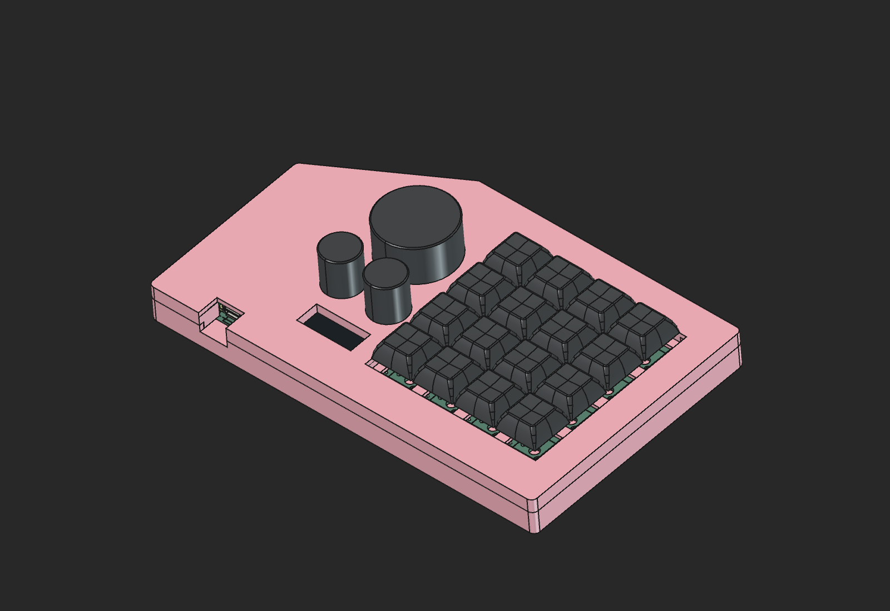
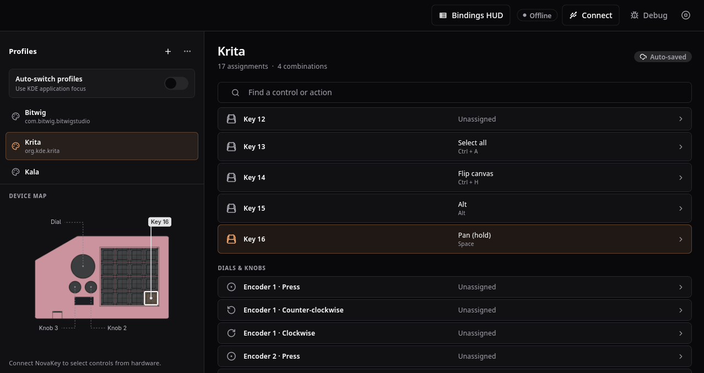

# NovaKey

An open-source 16-key macropad with three rotary encoders, custom firmware, and a companion configuration app.

## Novakey studio

Studio is the desktop app for the novakey. It can be used to configure profiles and keybinds

## Bill of materials

### Electronics

| Ref | Qty | Part | Footprint / notes |
| --- | --- | --- | --- |
| A1 | 1 | Raspberry Pi Pico | Through-hole ([datasheet](https://datasheets.raspberrypi.com/pico/pico-datasheet.pdf)) |
| U2 | 1 | 0.91" 128x32 I2C OLED (ER-OLEDM0.91-1) | I2C ([datasheet](https://www.buydisplay.com/download/manual/ER-OLEDM0.91-1_Datasheet.pdf)) |
| SW1–SW3 | 3 | EC11 rotary encoder with push switch | Alps EC11E, vertical, 20 mm shaft |
| SW4–SW19 | 16 | Kailh MX hotswap socket | MX 1.00u |
| D1–D16 | 16 | Signal diode (e.g. 1N4148) | DO-35 through-hole, 7.62 mm pitch |
| — | 1 | NovaKey PCB | Gerbers in `pcbway_production/` |

### Mechanical

| Qty | Part | Source |
| --- | --- | --- |
| 16 | MX-style switches | Any MX-compatible switch |
| 16 | 1u keycaps | Any MX-compatible keycaps |
| 3 | Encoder knobs | 3D printed, `CAD/Knob.FCStd` |
| 1 | Enclosure base | 3D printed, `CAD/enclosure_v3/Base_flat.stl` |
| 1 | Enclosure top | 3D printed, `CAD/enclosure_v3/Upper_flat_base.stl` |

The KiCad-exported BOM is in `kicad_files/bill_of_materials.csv`.
